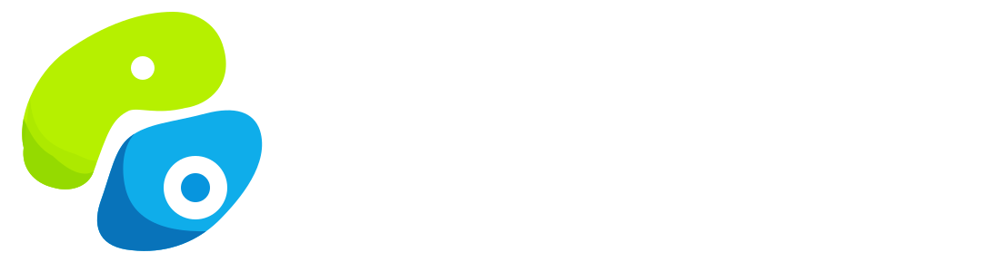
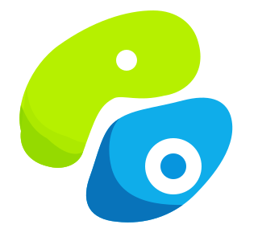

# AppKit

中文：[README.md](README.md)

## 1. Purpose

The layer shared by Climbio's apps (Hold Cat, Redpoint Cat, Climbio Studio): language-pack loading, add-to-home-screen state, photos and EXIF, dialogs and toasts, system sharing, IndexedDB helpers, shared styles. Pure front end, no build step, no dependency on Firebase or on any app's state.

- **Use it when**: you build a PWA and need one-language-at-a-time packs, dialogs / toasts (instead of `confirm` / `alert` / `prompt`), photo import (EXIF to camera position, orientation fix, thumbnail, re-encode), or add-to-home-screen state.
- **Do not use it for**: framework components, routing or state management. Each app's own logic (how stats are computed, backup, sign-in) is not here; this layer only does presentation and small utilities.

## 2. License and dependency rules

- AGPL-3.0 (`LICENSE`, `NOTICE`). It is part of Climbio and uses the same license. It ships third-party files in `qr/` (jsQR 1.4.0 Apache-2.0, qrcode-generator 1.4.4 MIT; see `qr/SOURCE.txt`, `qr/LICENSE-*`).
- May import: browser built-ins and files in this folder. Files see each other through the global `AppKit` (for example `ui.js` calls `AppKit.i18n.t` and falls back to the bare key when it is not loaded); there are no `import` dependencies.
- Must not import: `js/`, `holdscan/`, or other kits (kits are independent). No dependence on any app's `state`, element ids or branding.
- Exceptions (fully usable only inside the Climbio repo; not part of the standalone surface): `share-tools.js` loads `../appkit/qr/...` and reads `self.climbioT`; `nearby.js` depends on the global `ShareTools`. Neither file is in the exports of `index.js`; `share-tools.js` is also excluded from the npm package (`files` in `package.json`).

## 3. File map

In the browser, load the files you need in order; they attach to the global `AppKit` (ES-module apps also load them with `<script>` first, then read `globalThis.AppKit`).

| File | Responsibility |
|---|---|
| `index.js`, `index.mjs`, `index.d.ts` | Node / bundler entry: merges `i18n`, `install`, `photo`, `files`, `ui`, `store`, `account`, `landing`, `share`, `update`, `idb`, `backstack` into one object, with types |
| `i18n.js` | `AppKit.i18n`: language-pack loading (below), `t`, `apply` (`data-i18n*`), `use` (switch language), `cacheList` (for the Service Worker) |
| `install.js` | `AppKit.install`: add-to-home-screen state `track(...)`, `platform()`, `intentUrl(href)` (hand to the system on Android) |
| `photo.js` | `AppKit.photo`: `readExif`, `toCamera`, `load` (image URL to Image), `prepare` (import one photo), `toCanvas`, `jpeg`, `encode`, `reencode`, `thumb`, `sha256`, `view` (v2 photo view) |
| `files.js` | `AppKit.files`: `zip` (stored ZIP), `unzip` (including deflate), `rid` (random id), `safeName` (safe file name), `sha` (SHA-256, first N bytes as hex), `hash53` (cyrb53, a number), `base64` (Blob to base64) |
| `ui.js` | `AppKit.ui`: `ask`, `close`, `confirm`, `alert`, `prompt`, `toast`, `hideToast`, `configure` (hook up the app's back stack), `svg` (create SVG elements), `reducedMotion` (user asked for less motion); tracks `visualViewport` itself on load (`--vv-top`, `--vv-h`) |
| `account.js` | `AppKit.account`: `avatar(target, user)` shared avatar, `summary(target, values)` two-column stats, `stats(metrics)`, `detail({ title, metrics, note, groups })` profile card, `footer(target, { version, sourcesHref?, versionButton?, showUpdateStatus?, root? })` shared menu footer (`root`: site root, for pages not at the first level); presentation only, each app computes its own stats and provides the actions |
| `share.js` | `AppKit.share`: `sendLink` (system share a link, else copy), `sendFile` (system share a file, else download), `download`, `canShareFiles` |
| `share-image.js` | `AppKit.shareImage`: styled share images (story, post; full-bleed or card). The app draws the photo+route base; `make` lays it out with fonts, byline and logo (`symbolLogo`, `imageLogo`) |
| `store.js` | `AppKit.store`: `get(key, fallback)`, `set(key, value)` (returns whether it was stored), `remove(key)`; JSON over localStorage that never throws in private mode, when full, or on corrupt data |
| `gesture.js` | `AppKit.gesture`: `longPress(target, { item, onHold, ms, slop, vibrate, rightClick })` (long press; the click after a hold is swallowed; with `rightClick` a mouse right-click also calls `onHold`) |
| `timing.js` | `AppKit.timing`: `wait(ms)`, `timeoutSignal(ms)`, `fetchTimeout(url, options, ms)` (falls back where `AbortSignal.timeout` is missing, e.g. old iOS) |
| `update.js` | `AppKit.update`: `create({ host, apply })` "new version, Update" bar, `watch(fn)` re-checks when the page returns to the foreground or the network comes back (at least 1 minute apart); pairs with the `waiting` mode of `AppKit.sw` |
| `backup.mjs`, `backup-ui.mjs`, `collection-backup.mjs`, `crags.mjs` | Local backup and restore (`.climbio` files) and multi-crag ZIP export/import; ES modules used only by the two Climbio apps, not exposed on the `AppKit` global |
| `backstack.js` | `AppKit.backstack`: `open(id, onBack, state)` / `close(id)` / `handle()`; each dialog or popup takes one history entry so Back closes only the top one; hook it up with `AppKit.ui.configure({ backStack: { open, close } })` |
| `idb.js` | `AppKit.idb`: `opener({ name, version, upgrade, ready })` (reopens a closed connection), `done`, `packBlob` / `unpackBlob` (store large Blobs as ArrayBuffer on iPhone) |
| `nearby.js` | `AppKit.nearby`: `open({ app, endpoint, label, list, pack, take })` (nearby exchange: phones on the same network find each other and, after mutual confirmation, trade over WebRTC; discovery uses the cloud function `nearby`, texts are the `nearby*` keys in the shared language pack, spec in docs/sharing.md), `supported()` (only with WebRTC); without an endpoint it can only connect by scanning QR codes |
| `errors.js` | Error reporting for test builds: enabled only on test sites (`climbio-dev`, `climbio-eric` and their preview channels); uncaught errors and Errors passed to `console.error` go to the cloud function `clientError`, viewable in Google Cloud Error Reporting; production, localhost and self-hosted sites do not send. Each product page loads it first in `<head>`, right after the CSP |
| `recover.js` | Auto-repair on a failed load (synchronous in `<head>`, on every site): when online, unregisters the Service Worker, clears the app caches and reloads once, at most once in ten minutes. With `data-boot` (milliseconds) and optional `data-cache` (cache-name prefix) it also runs a boot watchdog: any same-origin script error before boot completes, or a missing `akBooted()` call, is a boot failure; it then activates a waiting worker or clears prefixed caches and reloads. Caches only; IndexedDB is left alone. Not exported from `index.js` |
| `landing.js` | `AppKit.landing`: desktop-only tools (the Wall workspace of Climbio Studio) show only an intro page on phones; tools that also work on phones (Studio home, Crag, Wall) use `ak-handset` instead (`isPhone`, `boot`; below) |
| `sw.js` | `AppKit.sw(options)`: Service Worker core (shared by Hold Cat, Redpoint Cat and Studio Crag); loaded with `importScripts` inside the Service Worker, not in the page |
| `share-tools.js` | Global `ShareTools` (not part of `AppKit`, not in `index.js`): fetching shared routes, walls and photos from any URL, route-link parsing, gzip, share packages, QR generation and scanning, in-memory files; fully usable only inside the Climbio repo (see the exceptions in section 2) |
| `qr/` | Same-origin third-party QR code (`qrcode.js`, `jsQR.js`), loaded by `share-tools.js` on demand |
| `components.css` | Structural styles for shared components: top bar `.bar`, round button `.icon-btn`, pill button `.btn`, bottom-right "+" `.rfab` (apps override only the differences; load before the app's own stylesheet) |
| `ui.css` | UI colors (brand tokens to `--bg`, `--surface`, `--text`, `--accent`, ...), dialog `.ak-dialog`, toast `.ak-toast`, list `.ak-list`, hint row `.ak-hint`, phone intro page `.ak-landing` |

The npm package (`@climbio/appkit`) ships these `files`: `*.js`, `*.mjs`, `*.d.ts`, `*.css`, `README.md`, `README.en.md`, `LICENSE`, `NOTICE` (the `qr/` subfolder is not included). `exports`: `.` (`import` to `index.mjs`, `require` to `index.js`), `./ui.css`, `./components.css`, `./*.js`, `./package.json`.

## 4. Public API

With npm: `import AppKit, { i18n, photo } from '@climbio/appkit'` (`require` works too), with TypeScript types; in Node only the DOM-free parts work (EXIF, language-pack lookups, `files.hash53`, `store` never throwing, and so on).

### 4.1 Language packs `AppKit.i18n`

Each app has one set of `i18n/<app>/<lang>.js`, and shared terms (OK, Cancel, the add-to-home-screen text, ...) have one set `i18n/common/<lang>.js`; a key lives in exactly one place (`tools/check.mjs` checks that every language has the same keys and that an app's pack does not repeat shared terms).

| Name | Notes |
|---|---|
| `LANGS` | `['zh', 'en', 'ja', 'fr', 'ko', 'es', 'de']` |
| `lang` | Current language (getter) |
| `add(app, lang, dict)` | Called from a pack file; values are strings, string arrays, or functions taking arguments |
| `detect(langs?, nav?)` | Picks by browser language: `zh` prefixes mean Chinese, other languages with a pack match by language code, otherwise English (Chinese-only apps always get Chinese) |
| `setting()` | The language chosen on this device (stored under `key` in localStorage); `'auto'` if never chosen |
| `boot({ app, key?, langs?, base? })` (`app` may be a list of folder names, looked up in order) | Call **synchronously** while the page is parsing, in `<head>` before the main program: decides the language, `document.write`s the shared and app packs, returns the language. `key`: localStorage key remembering the user's choice; `langs`: languages this app has (seven by default); `base`: relative URL of `i18n/` (default `../i18n/`). If the URL of `i18n.js` carries `?v=...`, the packs use the same suffix |
| `use(choice)` | `Promise<string>`: switch language (`'auto'` follows the browser), fetching only packs not yet loaded; remembers the choice when `key` is set; returns the actual language |
| `t(key, ...args)` | App pack, then shared terms, then the key itself (so missing translations are visible); function values are called with the arguments |
| `apply(scope?)` | Replaces `data-i18n` (text), `data-i18n-aria`, `data-i18n-title`, `data-i18n-ph` (placeholder), `data-i18n-content` (meta content), `data-i18n-html` (fixed HTML from the pack; only your own strings) |
| `cacheList(app, base?, langs?)` | Pack URLs for the Service Worker to cache (all languages, so switching works offline); call after `importScripts('../appkit/i18n.js')` in the Service Worker |
| `packs` | Registered packs, `packs[app][lang]` |

An undefined key returns the key itself; without `i18n.boot`, `ui`, `photo`, `files`, `share` and `install` need no language pack at all.

### 4.2 Add to home screen `AppKit.install`

The app draws its own UI; `track` detects the platform, captures Android Chrome's `beforeinstallprompt`, and remembers installed / dismissed (localStorage).

| Name | Notes |
|---|---|
| `platform(ua?, maxTouchPoints?)` | `{ ios, android, inApp, standalone }`; iPadOS reports a Mac UA and is told apart by touch points; `inApp` = in-app browsers of LINE, Messenger, IG and similar |
| `intentUrl(href)` | Android: an `intent://...` URL handing the page to the system; strips LINE's `openExternalBrowser` parameter |
| `track({ dismissedKey, installedKey, onChange?, onInstalled? })` | Starts tracking and returns a state object: platform flags, `canPrompt`, `installed`, `dismissed`, `offer` (not installed, not dismissed, installable: Android needs the install event; never offered when opened from the home screen), `prompt()` (shows the native install prompt when the event exists and returns `'accepted'` / `'dismissed'`, else `null`), `dismiss()`, `intentUrl` |

`inst.inApp`: in-app browsers (LINE, Messenger, IG, ...) cannot install, so ask the user to open in Safari / Chrome (on Android `inst.intentUrl(href)` can hand the page to the system). iPhone has no install event: when `prompt()` returns `null` the app shows "Share, then Add to Home Screen".

### 4.3 Photos `AppKit.photo`

| Name | Notes |
|---|---|
| `readExif(bytes)` | `ArrayBuffer｜Uint8Array` to `{ model?, time?, focal35?, lat?, lng?, alt?, accuracy?, heading?, headingRef?, pitch? }`; an empty object for non-JPEG or no EXIF. With several APP1 segments the first one read wins and later ones only fill missing fields; XMP pitch (drones) is read too |
| `toCamera(raw, { declination? })` | EXIF to a v2 `camera`; `undefined` when there is no position (or the coordinates are implausible or 0,0). Heading is true north: magnetic (ref `M`) gets the declination added (degrees, east positive); an unlabeled reference is treated as true north; focal length 0 means unknown |
| `MAX_EDGE`, `THUMB_EDGE` | 2560, 360 (default long-edge pixels) |
| `QUALITY` | JPEG qualities: `tiny` 0.75, `thumb` 0.8, `image` 0.86, `preview` 0.85, `crop` 0.9, `full` 0.92 |
| `prepare(file, { maxEdge?, thumbEdge?, quality?, preserveExif? })` | `{ raw (EXIF), image (orientation fixed, long edge within 2560, re-encoded without EXIF), thumb (long edge 360), w, h, sha256 }`. `preserveExif: true` keeps the original JPEG's EXIF, updating orientation and pixel size to match the rotated image and no longer referencing the old embedded thumbnail (default is to strip it) |
| `view({ id, name?, t?, license, attribution?, author?, origin?, w, h, sha256?, raw?, declination? })` | A v2 photo view (`kind: 'view'`, `surface: 'photo'`, `href` is `<id>.jpg`); `origin` defaults to `'self'` (taken by yourself); pass `origin: null` for paper or unknown-source photos, which must not be shared; `camera` is included when `raw` has a position |
| `toCanvas(file, maxEdge?)` | Canvas only (orientation fixed, long edge scaled within `maxEdge`, no scaling by default) |
| `load(src)` | Image URL (including `blob:` and `data:`) to a loaded `Image`; throws on failure |
| `jpeg(canvas, quality?)` | Canvas to JPEG Blob (no EXIF) |
| `encode(src, edge, quality)` | To `{ blob, w, h }` |
| `reencode(blob, quality?)` | Strips EXIF from an existing photo |
| `thumb(src, edge?)` | Blob or canvas to a thumbnail JPEG |
| `sha256(blob)` | To a hex string |

In Node only `readExif`, `toCamera` and `view` work (the rest need `createImageBitmap` and canvas).

### 4.4 Files `AppKit.files`

| Name | Notes |
|---|---|
| `rid(n = 16)` | n random characters from 0-9a-z |
| `safeName(name)` | Removes path and OS-forbidden characters and leading dots, at most 80 characters; empty becomes "未命名" (Untitled) |
| `sha(data, bytes = 32)` | SHA-256 of text, bytes or a Blob, first `bytes` bytes as a hex string |
| `hash53(str, seed = 0)` | cyrb53 hash (a number; for detecting content changes, not cryptographic) |
| `base64(blob)` | Blob to base64 (without the `data:` prefix) |
| `zip(entries)` | `[{ name, blob }]` to a ZIP Blob (stored, UTF-8 names) |
| `unzip(blob)` | ZIP Blob to `[{ name, blob }]` (stored or deflate; folder entries skipped); throws `Error('不是 ZIP 檔')` ("not a ZIP file") if it is not a ZIP |

### 4.5 Dialogs and toast `AppKit.ui`

Browser `confirm` / `alert` / `prompt` are not used. Dialogs are native `<dialog>` (top layer), one at a time (opening a new one cancels the old one); buttons use the app's own `.btn` (`.primary`, `.danger-fill`).

| Name | Notes |
|---|---|
| `ask({ title?, text?, fields?, choices?, body?, buttons?, role? })` | `Promise<{ button, values } \| undefined>`. `fields`: `[{ name, label, value, type, options: [[value, text]], placeholder, max, required }]`; `choices`: `[{ label, value, danger }]` (one option per row, closes on click); `body`: your own elements; `buttons`: `[{ label, value, primary, danger }]`, an empty `value` means cancel. `values` holds the trimmed fields; cancel (cancel key, Esc, click outside, Back) resolves `undefined`; an empty required field keeps the dialog open and refocuses it |
| `close()` | Closes the open dialog (counts as cancel) |
| `confirm(message, { title?, ok?, danger?, cancel? })` | `Promise<boolean>`; `danger`: red button; `cancel: false` shows a single button |
| `alert(message, { title?, ok? })` | OK only |
| `prompt({ title, value?, placeholder?, ok?, max?, allowEmpty? })` | One line of text: resolves the trimmed text, `null` on cancel; `max` defaults to 60 |
| `toast(text, { busy?, action?, ms? })` | One line at the bottom that fades after a few seconds (2.6 s by default, 5 s with an `action`); `busy: true` shows a spinner and does not auto-hide; `action: { label, run }` adds a button on the right (for example Undo) |
| `hideToast()` | Hides the toast immediately |
| `configure({ backStack })` | Hooks up the app's back stack: `backStack: { open(id, onBack), close(id) }`, where `close` returns a Promise (the dialog counts as closed once that history entry is popped); on Android Back closes the dialog first |
| `svg(tag, attrs?)` | Creates an SVG element (attributes set one by one) |
| `reducedMotion()` | Whether the user asked for reduced motion |

Button texts default to the shared pack keys `btnOk` and `cancel` (the bare key when no pack is loaded); you can also pass `ok` / `buttons` per call. When the app sets `--vv-top` and `--vv-h` (visualViewport; tracked automatically on load), dialogs occupy only the visible area above the keyboard; adjust the toast position with `--ak-toast-bottom`.

### 4.6 Sharing `AppKit.share`

| Name | Notes |
|---|---|
| `sendLink(url, { title?, text?, strictGesture? })` | System share of a link, else copy (with `text` it copies "text newline url"). Returns `'shared'`, `'copied'`, `'cancelled'`, `'failed'` (even copying failed), `'blocked'` (with `strictGesture`, iOS refused; sharing must happen at the moment of the tap, so the caller asks the user to tap again) |
| `sendFile(file, { title?, strictGesture? })` | System share of a file, else download. Returns `'shared'`, `'cancelled'`, `'downloaded'`, `'blocked'` (no download) |
| `download(blob, name, revokeAfter = 10000)` | Downloads a Blob through an invisible link |
| `canShareFiles(file?)` | Whether this device can system-share files |

### 4.7 Other utilities

| Name | Notes |
|---|---|
| `AppKit.store.get(key, fallback)` / `set(key, value)` / `remove(key)` | JSON over localStorage; `set` returns whether it was stored; never throws in private mode, when full, or on corrupt data |
| `AppKit.update.create({ host?, apply })` | Builds a (hidden by default) "new version, Update" bar and returns `{ el, show(), hide() }`; `host` is the container to put it in, otherwise it floats at the bottom; after pressing Update the button spins until `apply()` (may be async) finishes (usually a reload); if `apply` throws the button is restored. Texts are the shared pack keys `updateAvailable` and `update`; style `.ak-update` |
| `AppKit.update.watch(fn, { minGap? })` | Calls `fn` when the page returns to the foreground or the network comes back (at least `minGap` ms apart, 60000 by default); the app asks "is there a new version" inside `fn`; returns a cancel function |
| `AppKit.backstack.open(id, onBack, state?)` | Pushes one history entry (the same `id` is not opened twice); `onBack` runs when Back closes it |
| `AppKit.backstack.close(id)` | Use when closing it yourself (button, click outside): pops that entry (and any stacked above it) and resolves only after the pop; open the next screen inside `then`, otherwise the newly pushed entry would be undone by this Back |
| `AppKit.backstack.handle()` | The app's `popstate` asks this first: returns `true` when it was `close` popping by itself or Back closing the top dialog, so it is not treated as navigation; `depth`: current number of layers |
| `AppKit.idb.opener({ name, version, upgrade?, ready? })` | Returns an "open the database" function that shares one connection; when the browser closes the connection (iPhone Safari does after a failed write) or another tab upgrades, the next call reopens. `upgrade(db, oldVersion, tx)`: `onupgradeneeded`; `ready(db)`: runs after opening and before handing the connection to the caller (may be async) |
| `AppKit.idb.done(request)` | `IDBRequest` to `Promise` |
| `AppKit.idb.packBlob(v)` / `unpackBlob(v)` | iPhone (WebKit) fails when storing a larger Blob directly in IndexedDB, so it is stored as `{ $blob, buf: ArrayBuffer, type }` and turned back into a Blob on read; directly stored Blobs still read fine |
| `AppKit.account.avatar(target, user)` | Shared avatar: `user` is `{ name?, email?, photo? }` or `null` (empty silhouette); without an image it shows the first character of the name |
| `AppKit.account.summary(target, values)` | Fills the `[data-ak-stat]` fields inside `target`; a missing value shows a dash, never disguising empty data as 0 |
| `AppKit.account.stats(metrics)` | `[{ label, value }]` to `<div class="ak-account-details-stats">` |
| `AppKit.account.detail({ title?, metrics?, note?, groups? })` | Pure-DOM profile view; `groups`: `[{ title?, text?, metrics? }]` |
| `AppKit.nearby.open({ app, endpoint, label, list, pack, take })` | See below |
| `AppKit.nearby.start(mode, { app, label, suggested?, list, pack, take, sharePair?, takePair?, onClose? })` | Shared entry wiring (Hold Cat, Redpoint Cat and Studio all use it): ensure a nickname (`suggested` is the suggested nickname, a string or a function) → `open`; `endpoint` comes from the site config `SITE.cloud.nearby`; `label` may be a function returning a string |
| `AppKit.nearby.bind(button, mode, adapter, before?)` | Wire an entry button to `start`: hidden when WebRTC is unsupported; runs `before` (e.g. closing a menu) first |
| `AppKit.nearby.supported()`, `MAX_BYTES` | Available only with WebRTC; at most 150 MB per exchange (the receiver has the same limit) |
| `AppKit.nearby.paired()`, `compatible(a, b)` | How many devices are paired (one pairing list shared by all apps); whether two apps sync under My devices (same app, or either side is `studio`) |
| `AppKit.landing.isPhone({ touch, coarse, w, h })`, `boot()` | See below |
| `AppKit.sw(options)` | See below |

**Nearby exchange** (`nearby.open`): `app` is `'hold'`, `'redpoint'` or `'studio'`. Pairing is shared by all apps (`localStorage` key `climbio.nearby.pairs`); My devices only connects compatible apps (the same app, or either side is Studio) and Send to others only the same app. The last argument of `list`, `pack` and `take` is the peer's app (`peerApp`); Studio uses it to decide what to exchange. `list: async (trusted, peerApp) => [{ id, name, sub?, v, t? }]` (what I can give; `v` is an array of content strings; if the peer has the same `id` and its `v` covers mine, the item is unselected by default, with no time comparison); `pack: async (id) => ({ name, entry, files: [{ path, bytes: Uint8Array }] })` (packs one item, `entry` is the entry file); `take: async (bundle) => {}` (receives one item, `bundle = { id, name, entry, url }`, where `url` is `mem://...`, read with `ShareTools.open`); returns `{ close() }`. Discovery and relaying of connection messages use the cloud function `nearby` (it only relays messages and never touches data); data travels over the DataChannel between the phones. With no `endpoint` (self-hosted site, backend none, unreachable) only QR scanning remains: one side shows an offer, the other scans it and shows an answer, the first side scans that back and they connect, with no server at all. It cannot work without WebRTC, so the app hides the entry (check `supported()`). Texts are the shared pack's `nearby*` keys, with Traditional Chinese fallbacks when no pack is loaded. Style `.ak-nearby`.

**Phone intro page** (`landing`): desktop-only tools load `landing.js` synchronously in `<head>` (the CSP forbids inline scripts): on a phone (touch and screen short edge under 600, also when rotated; iPad mini and foldable inner screens count as tablets and open normally) it adds `ak-phone` to `html`, hides the whole app UI, and shows only the `.ak-landing` in `body`; opened from the home screen it opens normally; localhost and 127.0.0.1 are not judged, add `?phone` to preview; for phone testing add `?app` to force the tool open (remembered in sessionStorage). On phones it also removes `link[rel=manifest]` so the browser does not offer to install. There is no "open anyway". Tools that also work on phones set `data-ak-phone="app"` on `html`: no intro page, and the same detection adds `ak-handset` to `html` so the page can switch to a phone layout and hide features unsuited to phones. `[data-ak-url]` shows this page's URL and `[data-ak-copy]` copies it on click (the attribute value is the toast shown afterwards). The intro page content is written by each app in its own page:

```html
<section class="ak-landing">
  <header class="ak-ld-bar"><a href="../"></a></header>
  <div class="ak-ld-hero"><h1>Climbio Studio</h1><span class="ak-ld-tag">Wall · Crag · Desktop</span><p>One-line intro</p></div>
  <ul class="ak-ld-feats"><li><b>Feature</b><span>Description</span></li></ul>
  <div class="ak-ld-open"><b>Open on a computer</b><span>Note</span><code data-ak-url></code><button class="ak-ld-copy" data-ak-copy="URL copied">Copy URL</button></div>
</section>
```

**Service Worker core** (`AppKit.sw`, called inside the Service Worker): opening the app always asks the network first and only uses the stored copy offline.

| Option | Notes |
|---|---|
| `cache` | Cache name for this version |
| `prefix` | Start of this app's cache names (default `cache`); on activation only caches with this prefix that are neither `cache` nor in `keep` are deleted |
| `keep` | Cache names never deleted |
| `home` | URL of the app's home page (relative to the Service Worker); navigation requests for opening the app (including queries such as `?s=`) all map to it |
| `shell` | Files to precache (relative to the Service Worker); stored at install under versioned URLs, all of them required: an incomplete download fails the install and the old version keeps running |
| `version` | Version string used for the `?v=` URL suffix when there is a `shell` (the leading `climbio-` is removed) |
| `waiting` | `true` = the new version waits for the user to press update (a `SKIP_WAITING` message); by default it takes over right after installing |
| `bypass(url)`, `handle(url, req)` | URLs that skip this layer; requests handled yourself (return a Promise of a Response, or `null` to decline) |
| `timeout` | Milliseconds a navigation waits for the network, 3000 by default, after which the stored page is used |

Navigation is network first; resources with `?v=` are cache first; other resources are network first, stored when fetched and read from the store offline; `?check`, `/__/` and cross-origin requests bypass it.

**Error reporting** (`errors.js`): exports nothing; on load it registers `error`, `unhandledrejection` and `console.error` handlers on test sites; the same error is sent once per page and at most 10 per page; it sends only the message, error location, app, page path (without `#` and `?`), version and browser.

## 5. Data format and invariants

- **Language pack**: `AppKit.i18n.add('hold', 'zh', { app: '岩點貓', routesN: (n) => `${n} 條路線` })`; values are strings, string arrays or functions. A key lives in one place only.
- **v2 photo view** (output of `photo.view`): `{ climbio: 2, kind: 'view', surface: 'photo', id, t, license, attribution, author?, origin?, href: '<id>.jpg', w, h, mime: 'image/jpeg', name?, sha256?, camera? }`; `origin` is only `'self'` or absent, and absent means it cannot be shared.
- **camera**: `{ position: [lng, lat] or [lng, lat, alt], accuracy?, heading? (0 to 360, true north), pitch? (within 90), t?, focal?, model? }`; `position` is required, with longitude / latitude rounded to 7 decimals and altitude to 1.
- **ZIP**: `zip` stores without compression (photos are JPEG already) with UTF-8 names; `unzip` supports stored and deflate.
- **Nearby exchange protects strangers’ privacy**: `nearby.js` `join` and the WebRTC `who` message only carry the per-session "app name + anonymous code"; a custom device name is sent only in the `pair/paired` messages after both sides confirm pairing, or in a `name` message after the key check passes. Real device names are never shown before pairing, and an unverified `name` is never written to the pairing record; the hold cat and the redpoint cat share one implementation.
- **Shared components are self-contained**: inputs, buttons, rename and confirm dialogs use `AppKit.ui` first; their layout, type size, borders and focus styles live in `ui.css` and never depend on one app’s private CSS. After a change, open the same interaction once in each app.
- **Toast / dialog**: one dialog at a time; one toast, with a new one replacing the old.
- **history**: `backstack` uses one `history.pushState` per open dialog or popup; `close` pops with `history.go(-k)` and resolves only after the pop.
- `idb.packBlob` format: `{ $blob: true, buf: ArrayBuffer, type }`.
- `store` values are always JSON; unreadable or corrupt values give `fallback`.
- `AppKit.install.track` writes to localStorage: `installedKey` = `'true'`, `dismissedKey` = a timestamp (milliseconds as a string).

## 6. Minimal runnable example

### Without Climbio's brand styles

All colors in `ui.css` come from `--brand-*` variables (the Climbio site keeps them in `css/brand-tokens.css`, which this package does not include): without them dialog cards, toasts and lists are transparent. For your own site there are two options: load your own token file, or put the set below on the page (swap in your own colors) and give `<html>` `data-climbio-theme="indoor"` (dark background) or `"outdoor"` (white background):

```html
<html data-climbio-theme="indoor">
<style>
:root {
  --brand-bg: #0E0E0F; --brand-surface: #161618; --brand-surface-2: #1E1E21; --brand-surface-hover: #26262A;
  --brand-line: #2C2C30; --brand-line-strong: #3C3C42; --brand-control: #1E1E21;
  --brand-text: #F2F2F0; --brand-text-muted: #A8A8A4; --brand-text-dim: #8A8A86;
  --brand-action: #7CFF3A; --brand-action-hover: #95FF5E; --brand-on-action: #0E0E0F; --brand-action-soft: #1B2A14;
  --brand-danger: #FF5A4F; --brand-on-danger: #0E0E0F; --brand-overlay: rgba(0, 0, 0, 0.6); --brand-shadow: rgba(0, 0, 0, 0.5);
}
</style>
<link rel="stylesheet" href="node_modules/@climbio/appkit/ui.css">
```

Language packs belong to the caller too: `i18n.js` reads `i18n/<app>/<lang>.js` (registered with `AppKit.i18n.add`); without `i18n.boot`, call `ui`, `photo`, `files`, `share` and `install` directly and no language pack is needed; pass `ok` to `ui.confirm` per call for button text (`ui.configure` only uses `backStack`); with no shared pack loaded and no text passed, button text is the bare key (`btnOk`, `cancel`).

### Browser example (after `npm install @climbio/appkit`, with the styles above in a `<style>`)

```html
<html data-climbio-theme="indoor">
<link rel="stylesheet" href="node_modules/@climbio/appkit/ui.css">
<script src="node_modules/@climbio/appkit/i18n.js"></script>
<script src="node_modules/@climbio/appkit/photo.js"></script>
<script src="node_modules/@climbio/appkit/files.js"></script>
<script src="node_modules/@climbio/appkit/ui.js"></script>
<script src="node_modules/@climbio/appkit/share.js"></script>
<input id="pick" type="file" accept="image/*">
<script>
  document.getElementById('pick').onchange = async (e) => {
    const p = await AppKit.photo.prepare(e.target.files[0]);        // { raw, image, thumb, w, h, sha256 }
    const view = AppKit.photo.view({ id: 'p1', license: 'CC-BY-SA-4.0', attribution: 'me', w: p.w, h: p.h, sha256: p.sha256, raw: p.raw });
    if (await AppKit.ui.confirm(`${p.w}×${p.h}, use this photo?`, { ok: 'Use' })) {
      const zip = await AppKit.files.zip([{ name: view.href, blob: p.image }, { name: 'view.json', blob: new Blob([JSON.stringify(view)]) }]);
      AppKit.ui.toast(`${zip.size} bytes`);
    }
  };
</script>
```

Add to home screen and language packs:

```js
AppKit.i18n.add('demo', 'zh', { greet: (n) => `你好 ${n}` });   // the call inside a pack file
AppKit.i18n.boot({ app: 'demo', key: 'demo.lang' });             // call synchronously in <head>
const t = AppKit.i18n.t;                                          // t('greet', 'A')
const inst = AppKit.install.track({ dismissedKey: 'my.installDismissedAt', installedKey: 'my.installed', onChange: render });
bar.hidden = !inst.offer;
go.onclick = async () => { if (!await inst.prompt()) showSteps(inst.ios); };
close.onclick = () => inst.dismiss();
```

Node (ESM, DOM-free parts; expected output `[ 121.56, 25.03 ] 5059922895146125 en`):

```js
import { photo, files, i18n } from '@climbio/appkit';
console.log(photo.toCamera({ lat: 25.03, lng: 121.56 })?.position, files.hash53('abc'), i18n.detect(['zh', 'en'], 'en-US'));
```

## 7. Limits and known trade-offs

- **Load order**: `i18n.js` before the language packs; `i18n.boot` uses `document.write`, so it can only be called synchronously while the page is parsing (in `<head>` or at the end of the page, before the main program), never with `async` / `defer`; `landing.js` goes in `<head>`; `errors.js` goes first in `<head>` right after the CSP; `update.js` reads the global `AppKit.i18n` (Chinese defaults when it is not loaded); `sw.js` is loaded only with `importScripts` inside a Service Worker.
- **Browser only**: `ui`, `update`, `landing`, `account`, `backstack` and `nearby` need the DOM; `photo` encoding needs `createImageBitmap` and canvas; `files.sha` and `files.rid` need `crypto`; deflate in `files.unzip` needs `DecompressionStream`; Node can use `readExif`, `toCamera`, `view`, `hash53`, `safeName`, `i18n` (lookups) and `store`.
- **Outside the exports of `index.js` / `index.mjs`**: `nearby`, `sw`, `errors`, `recover`, `share-tools.js` (`ShareTools`) and `qr/` can only be loaded with `<script>`.
- `nearby` and `share-tools.js` depend on language packs and cloud functions inside the Climbio repo; they are not part of the standalone surface.
- Without the `--brand-*` variables `ui.css` cards are transparent (see section 6); the token file `css/brand-tokens.css` is not in the package.
- The phone test for desktop-only tools is "touch and screen short edge under 600", using `screen.width` / `screen.height`, not the window size.
- Photos: `prepare` strips EXIF by default; use `preserveExif: true` only for shares that must keep shooting information.
- `AppKit.update` pairs with the `waiting` mode of `AppKit.sw` (offline first, whole-version cache, no mixed versions).

### Mobile photo layout

`ui.css` shares Hold Cat's and Redpoint Cat's photo cards (`.walls` / `.ak-photo-grid`, `.wall-card` / `.ak-photo-card`), long-press card actions (`.card-acts`, `.card-act`) and the tools above a photo (`.vw`, `.vw-btn`, `.vw-back`, `.vw-edit`, `.vw-share`). Two-column square photos, bottom gradient text, rounded corners and tools follow the same rules in both apps. `.ak-photo-page` makes the Topo fill the available height with the top tools floating over the photo; each app handles its own bottom tools and actions.

## 8. Verification

| Check | Command |
|---|---|
| Language, text, platform, phone-intro detection, photo view, ZIP | `node --test tools/appkit.test.mjs` |
| IndexedDB helpers | `node --test tools/appkit-idb.test.mjs` |
| Short links, sharing | `node --test tools/appkit-share.test.mjs` |
| Package exports consistent (ESM named exports equal CJS, type file declares every export, files listed in `files` / `exports` exist, server-side load does not break) | `node --test tools/kit-packages.test.mjs` |
| External page, package only: photo import, ZIP, add to home screen, dialogs (needs a Playwright browser) | internal e2e cases |
| Language-pack keys consistent, every used key exists | `node tools/check.mjs` |
