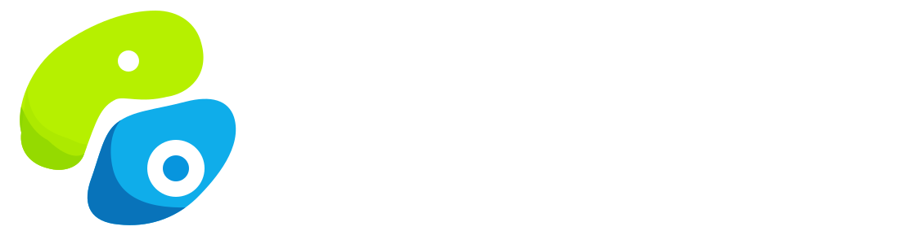

# AppKit

English: [README.en.md](README.en.md)

## 1. 用途

Climbio 各 App（岩點貓、紅點貓、Climbio Studio）共用的一層：語言包載入、加到主畫面、照片與 EXIF、對話框與提示、系統分享、IndexedDB 小工具、共用樣式。純前端，沒有建置步驟，不依賴 Firebase 或任何 App 的狀態。

- **該用**：做 PWA，需要一次一種語言的語言包、對話框／toast（取代 `confirm`／`alert`／`prompt`）、照片匯入（EXIF → 相機位置、轉正、縮圖、重新編碼）、加到主畫面的狀態。
- **不該用**：需要框架元件、路由、狀態管理；各 App 自己的邏輯（統計怎麼算、備份、登入）不在這裡，這裡只做呈現與小工具。

## 2. 授權與依賴規則

- AGPL-3.0（`LICENSE`、`NOTICE`）。它是 Climbio 的一部分，採同一份授權。內附 `qr/` 的第三方檔案（jsQR 1.4.0 Apache-2.0、qrcode-generator 1.4.4 MIT，見 `qr/SOURCE.txt`、`qr/LICENSE-*`）。
- 可以 import：瀏覽器內建、本資料夾的檔案。檔案之間用全域 `AppKit` 互相看到（例如 `ui.js` 用 `AppKit.i18n.t`，沒載入時退回 key 本身），沒有 `import` 相依。
- 不可以 import：`js/`、`holdscan/`、其他 kit（kit 彼此獨立）。不依賴任何 App 的 `state`、元素 id、品牌。
- 例外（只有 Climbio repo 內能完整使用，不屬於獨立可用的部分）：`share-tools.js` 會載入 `../appkit/qr/…` 並讀 `self.climbioT`；`nearby.js` 依賴全域 `ShareTools`。這兩個檔案不在 `index.js` 的匯出裡；`share-tools.js` 也不進 npm 套件（`package.json` 的 `files` 排除）。

## 3. 檔案地圖

瀏覽器依序載入要用的檔案，掛在全域 `AppKit`（ES module 的 App 一樣先用 `<script>` 載入，再讀 `globalThis.AppKit`）。

| 檔案 | 責任 |
|---|---|
| `index.js`、`index.mjs`、`index.d.ts` | Node／打包工具入口：把 `i18n`、`install`、`photo`、`files`、`ui`、`store`、`account`、`landing`、`share`、`update`、`idb`、`backstack` 合成一個物件，附型別 |
| `i18n.js` | `AppKit.i18n`：語言包載入（見下面）、`t`、`apply`（`data-i18n*`）、`use`（換語言）、`cacheList`（給 Service Worker） |
| `install.js` | `AppKit.install`：加到主畫面的狀態 `track(…)`、`platform()`、`intentUrl(href)`（Android 交給系統打開） |
| `photo.js` | `AppKit.photo`：`readExif`、`toCamera`、`load`（圖片網址 → Image）、`prepare`（匯入一張照片）、`toCanvas`、`jpeg`、`encode`、`reencode`、`thumb`、`sha256`、`view`（v2 照片畫面） |
| `files.js` | `AppKit.files`：`zip`（不壓縮的 ZIP）、`unzip`（含 deflate）、`rid`（隨機 id）、`safeName`（安全檔名）、`sha`（SHA-256 取前 N 位元組的 hex）、`hash53`（cyrb53，數字）、`base64`（Blob 轉 base64） |
| `ui.js` | `AppKit.ui`：`ask`、`close`、`confirm`、`alert`、`prompt`、`toast`、`hideToast`、`configure`（接 App 的返回紀錄）、`svg`（建 SVG 元素）、`reducedMotion`（使用者要求減少動態）；載入時自己追蹤 `visualViewport`（`--vv-top`、`--vv-h`） |
| `account.js` | `AppKit.account`：`avatar(target, user)` 共用頭像、`summary(target, values)` 兩欄統計、`stats(metrics)`、`detail({ title, metrics, note, groups })` 個人資料卡、`footer(target, { version, sourcesHref?, versionButton?, showUpdateStatus?, root? })` 共用帳號選單底部（root：網站根目錄，頁面不在第一層時給）；各 App 負責操作 |
| `share.js` | `AppKit.share`：`sendLink`（系統分享連結，不行就複製）、`sendFile`（系統分享檔案，不行就下載）、`download`、`canShareFiles` |
| `share-image.js` | `AppKit.shareImage`：分享用的風格圖片（限時動態、貼文；滿版、卡片）。App 畫好照片與路線的底圖，`make` 負責版面、字型、署名與 logo（`symbolLogo`、`imageLogo`） |
| `store.js` | `AppKit.store`：`get(key, fallback)`、`set(key, value)`（回傳存成與否）、`remove(key)`；localStorage 的 JSON 讀寫，私密模式、空間滿了、資料壞掉都不丟例外 |
| `gesture.js` | `AppKit.gesture`：`longPress(target, { item, onHold, ms, slop, vibrate, rightClick })`（長按；放開的 click 不往下傳；`rightClick` 開著時滑鼠右鍵也呼叫 `onHold`） |
| `timing.js` | `AppKit.timing`：`wait(ms)`、`timeoutSignal(ms)`、`fetchTimeout(url, options, ms)`（舊版 iOS 沒有 AbortSignal.timeout 時自動退回） |
| `update.js` | `AppKit.update`：`create({ host, apply })`「有新版本　更新」提示條、`watch(fn)` 回到前景／恢復網路時檢查（間隔至少 1 分鐘）；搭配 `AppKit.sw` 的 `waiting` 模式 |
| `backup.mjs`、`backup-ui.mjs`、`collection-backup.mjs`、`crags.mjs` | 本機備份與復原（`.climbio` 檔）、岩場匯出入的 ZIP；ES module，只有 Climbio 的兩款 App 使用，不經過 `AppKit` 全域 |
| `backstack.js` | `AppKit.backstack`：`open(id, onBack, state)`／`close(id)`／`handle()`；對話框、彈窗各佔一層 history，返回只關最上面那個；`AppKit.ui.configure({ backStack: { open, close } })` 接上 |
| `idb.js` | `AppKit.idb`：`opener({ name, version, upgrade, ready })`（連線被關掉自動重開）、`done`、`packBlob`／`unpackBlob`（iPhone 大 Blob 存成 ArrayBuffer） |
| `nearby.js` | `AppKit.nearby`：`open({ app, endpoint, label, mode, list, pack, take, sharePair, takePair })`（附近交換：`mode: 'send'` 傳給別人，勾選附近的人、對方手動收下；`mode: 'devices'` 我的裝置，配對後自動雙向同步；用 WebRTC 直接傳，找人靠雲端函式 `nearby`，文字在共用語言包的 `nearby*`，規格見 docs/sharing.md）、`supported()`（有 WebRTC 才有）；沒有 endpoint 時只能掃 QR code 連線 |
| `errors.js` | 測試版的錯誤回報：只在測試版網站（`climbio-dev`、`climbio-eric` 和它們的預覽頻道）開，沒接住的錯誤和 `console.error` 帶的 Error 送到雲端函式 `clientError`，在 Google Cloud 的 Error Reporting 看；正式版、本機、自架的站不送。每個產品頁面在 `<head>` 的 CSP 後面第一個載入 |
| `recover.js` | 載入失敗時自動修復（在 `<head>` 同步載入，所有網站都開）：有網路時解除 Service Worker、清 App 快取再重新整理一次，十分鐘內最多一次。頁面加上 `data-boot`（毫秒）與可選的 `data-cache`（快取名稱前綴）時另開開機看門狗：開機完成前攔截自家腳本錯誤，主程式須呼叫 `akBooted()`；失敗則讓等待中的新版接手，或清前綴快取後重載。只清快取，不動 IndexedDB。不在 `index.js` 匯出 |
| `landing.js` | `AppKit.landing`：電腦版工具（Climbio Studio 的 Wall）在手機只顯示介紹頁；手機也能用的工具（Studio 首頁、Crag、Wall）改加 `ak-handset`（`isPhone`、`boot`，見下面） |
| `sw.js` | `AppKit.sw(options)`：Service Worker 核心（岩點貓、紅點貓、Studio Crag 共用）；在 Service Worker 裡 `importScripts` 載入，不在頁面載入 |
| `share-tools.js` | 全域 `ShareTools`（不是 `AppKit` 的一部分，不在 `index.js`）：收線（從任何網址讀路線圖層、牆和照片）、解析路線連結、gzip、分享包、QR 產生與掃描、記憶體檔案；只在 Climbio repo 內完整可用（見第 2 節的例外） |
| `qr/` | 同源的第三方 QR 程式（`qrcode.js`、`jsQR.js`），`share-tools.js` 用到才載入 |
| `components.css` | 共用元件的結構樣式：頂端列 `.bar`、圓形鈕 `.icon-btn`、膠囊鈕 `.btn`、右下「＋」`.rfab`（各 App 只覆蓋差異；在 App 自己的樣式表之前載入） |
| `ui.css` | 介面色（品牌 token → `--bg`、`--surface`、`--text`、`--accent`…）、對話框 `.ak-dialog`、提示 `.ak-toast`、清單 `.ak-list`、提示列 `.ak-hint`、手機介紹頁 `.ak-landing` |

npm 套件（`@climbio/appkit`）的 `files`：`*.js`、`*.mjs`、`*.d.ts`、`*.css`、`README.md`、`README.en.md`、`LICENSE`、`NOTICE`（`qr/` 子資料夾不在套件裡）。`exports`：`.`（`import` → `index.mjs`、`require` → `index.js`）、`./ui.css`、`./components.css`、`./*.js`、`./package.json`。

## 4. 公開 API

用 npm：`import AppKit, { i18n, photo } from '@climbio/appkit'`（`require` 也可以），附 TypeScript 型別；Node 只用得到不碰 DOM 的部分（EXIF、語言包的查詢、`files.hash53`、`store` 不會丟例外等）。

### 4.1 語言包 `AppKit.i18n`

每個 App 一組 `i18n/<app>/<語言>.js`，共用名詞（確定、取消、加到主畫面的說明…）一組 `i18n/common/<語言>.js`；同一個 key 只放一處（`tools/check.mjs` 會檢查各語言的 key 一致、App 的語言包不重複共用名詞）。

| 名稱 | 說明 |
|---|---|
| `LANGS` | `['zh', 'en', 'ja', 'fr', 'ko', 'es', 'de']` |
| `lang` | 目前的語言（getter） |
| `add(app, lang, dict)` | 語言包檔案呼叫；值是字串、字串陣列，或帶參數的函式 |
| `detect(langs?, nav?)` | 依瀏覽器語言挑：`zh` 開頭是中文，其他有語言包的照語言碼，沒有的英文（只有中文的 App 一律中文） |
| `boot({ app, langs?, base? })`（`app` 可以是一串資料夾名，依序找 key） | 開頁時在 `<head>` **同步**呼叫（要在主程式之前）：決定語言、`document.write` 共用名詞與 App 的語言包，回傳語言。`key`：記住使用者選擇的 localStorage key；`langs`：這個 App 有的語言（預設七種）；`base`：`i18n/` 的相對網址（預設 `../i18n/`）。載入 `i18n.js` 的網址帶 `?v=…` 時，語言包用同一個後綴 |
| `t(key, ...args)` | App 的語言包 → 共用名詞 → key 本身（看得出漏翻）；值是函式就帶參數呼叫 |
| `apply(scope?)` | 換掉 `data-i18n`（文字）、`data-i18n-aria`、`data-i18n-title`、`data-i18n-ph`（placeholder）、`data-i18n-content`（meta 的 content）、`data-i18n-html`（語言包裡固定的 HTML，只放自己寫的字串） |
| `cacheList(app, base?, langs?)` | Service Worker 要快取的語言包網址（全部語言，離線時也能切換）；Service Worker 裡 `importScripts('../appkit/i18n.js')` 後呼叫 |
| `packs` | `packs[app][語言]` 已註冊的語言包 |

沒有定義的 key 回傳 key 本身；不用 `i18n.boot` 時，`ui`、`photo`、`files`、`share`、`install` 都不需要任何語言包。

### 4.2 加到主畫面 `AppKit.install`

畫面由 App 自己畫；`track` 判斷平台、攔下 Android Chrome 的 `beforeinstallprompt`、記住裝過與按掉了（localStorage）。

| 名稱 | 說明 |
|---|---|
| `platform(ua?, maxTouchPoints?)` | `{ ios, android, inApp, standalone }`；iPadOS 用 Mac 的 UA，用觸控點分辨；`inApp`＝LINE、Messenger、IG 等內建瀏覽器 |
| `intentUrl(href)` | Android：`intent://…` 網址，交給系統打開；拿掉 LINE 的 `openExternalBrowser` 參數 |
| `track({ dismissedKey, installedKey, onChange?, onInstalled? })` | 開始追蹤，回傳狀態物件：平台旗標、`canPrompt`、`installed`、`dismissed`、`offer`（還沒裝、沒按掉、裝得了：Android 要有安裝事件；從主畫面打開的不出現）、`prompt()`（有安裝事件就跳原生安裝，回 `'accepted'`／`'dismissed'`，沒有回 `null`）、`dismiss()`、`intentUrl` |

`inst.inApp`：LINE、Messenger、IG 等內建瀏覽器裝不了，請改用 Safari／Chrome 打開（Android 可以用 `inst.intentUrl(href)` 交給系統）。iPhone 沒有安裝事件：`prompt()` 回 `null` 時 App 顯示「分享 → 加入主畫面」。

### 4.3 照片 `AppKit.photo`

| 名稱 | 說明 |
|---|---|
| `readExif(bytes)` | `ArrayBuffer｜Uint8Array` → `{ model?, time?, focal35?, lat?, lng?, alt?, accuracy?, heading?, headingRef?, pitch? }`；不是 JPEG 或沒有 EXIF 是空物件。好幾段 APP1 時先讀到的為準，後面的只補沒有的欄位；XMP 的俯仰（空拍機）也讀 |
| `toCamera(raw, { declination? })` | EXIF → v2 的 `camera`；沒有位置（或座標不合理、0,0）回傳 `undefined`。朝向以正北為準：磁北（ref `M`）加上磁偏角（度，東為正）；沒標基準的當成正北；焦距 0 是不明 |
| `MAX_EDGE`、`THUMB_EDGE` | 2560、360（長邊像素預設值） |
| `QUALITY` | JPEG 品質：`tiny` 0.75、`thumb` 0.8、`image` 0.86、`preview` 0.85、`crop` 0.9、`full` 0.92 |
| `prepare(file, { maxEdge?, thumbEdge?, quality?, preserveExif? })` | `{ raw（EXIF）, image（轉正、長邊 2560 以內、重新編碼不帶 EXIF）, thumb（長邊 360）, w, h, sha256 }`。`preserveExif: true`：保留原 JPEG 的 EXIF，轉正後的方向、像素尺寸同步更新，不再引用舊內嵌縮圖（預設移除） |
| `view({ id, name?, t?, license, attribution?, author?, origin?, w, h, sha256?, raw?, declination? })` | v2 照片畫面（`kind: 'view'`、`surface: 'photo'`，`href` 是 `<id>.jpg`）；`origin` 預設 `'self'`（自己拍的），紙本、來源不明的照片傳 `origin: null`，不能分享出去；`raw` 有位置時帶 `camera` |
| `toCanvas(file, maxEdge?)` | 只要畫布（轉正、長邊縮到 `maxEdge` 以內，預設不縮） |
| `load(src)` | 圖片網址（含 `blob:`、`data:`）→ 載入好的 `Image`；失敗就丟錯 |
| `jpeg(canvas, quality?)` | 畫布 → JPEG Blob（不帶 EXIF） |
| `encode(src, edge, quality)` | → `{ blob, w, h }` |
| `reencode(blob, quality?)` | 已有的照片拿掉 EXIF |
| `thumb(src, edge?)` | Blob 或畫布 → 縮圖 JPEG |
| `sha256(blob)` | → 十六進位字串 |

Node 只用得到 `readExif`、`toCamera`、`view`（其餘需要 `createImageBitmap`、畫布）。

### 4.4 檔案 `AppKit.files`

| 名稱 | 說明 |
|---|---|
| `rid(n = 16)` | n 個 0-9a-z 的隨機字元 |
| `safeName(name)` | 去掉路徑與系統不收的字元、開頭的點，最長 80 字；空的是「未命名」 |
| `sha(data, bytes = 32)` | 文字、位元組或 Blob 的 SHA-256 取前 `bytes` 個位元組，十六進位字串 |
| `hash53(str, seed = 0)` | cyrb53 雜湊（數字，比對內容有沒有變，不是密碼學用途） |
| `base64(blob)` | Blob → base64（不含 `data:` 前綴） |
| `zip(entries)` | `[{ name, blob }]` → ZIP Blob（不壓縮，檔名 UTF-8） |
| `unzip(blob)` | ZIP Blob → `[{ name, blob }]`（不壓縮或 deflate；資料夾項目略過）；不是 ZIP 丟 `Error('不是 ZIP 檔')` |

### 4.5 對話框與提示 `AppKit.ui`

不用瀏覽器的 confirm／alert／prompt。對話框是原生 `<dialog>`（在最上層），同時只有一個，再開新的舊的當成取消；按鈕用 App 自己的 `.btn`（`.primary`、`.danger-fill`）。

| 名稱 | 說明 |
|---|---|
| `ask({ title?, text?, fields?, choices?, body?, buttons?, role? })` | `Promise<{ button, values } \| undefined>`。`fields`：`[{ name, label, value, type, options: [[值, 文字]], placeholder, max, required }]`；`choices`：`[{ label, value, danger }]`（一列一個選項，點了就關）；`body`：自己的元素；`buttons`：`[{ label, value, primary, danger }]`，`value` 空的是取消。`values` 是去掉頭尾空白的欄位；取消（取消鍵、Esc、點外面、返回）回傳 `undefined`；必填的空著不關，焦點回到那一格 |
| `close()` | 關掉打開中的對話框（當成取消） |
| `confirm(message, { title?, ok?, danger?, cancel? })` | `Promise<boolean>`；`danger`：紅色按鈕；`cancel: false` 只有一個按鈕 |
| `alert(message, { title?, ok? })` | 只有「確定」 |
| `prompt({ title, value?, placeholder?, ok?, max?, allowEmpty? })` | 一行文字：回傳去掉頭尾空白的文字，取消是 `null`；`max` 預設 60 |
| `toast(text, { busy?, action?, ms? })` | 畫面下方一行，幾秒後淡掉（預設 2.6 秒，有 `action` 是 5 秒）；`busy: true` 轉圈不自動消失；`action: { label, run }` 右邊多一顆按鈕（例如「復原」） |
| `hideToast()` | 立刻收起提示 |
| `configure({ backStack })` | 接 App 的返回紀錄：`backStack: { open(id, onBack), close(id) }`，`close` 回傳 Promise（退完那一層才算關好）；Android 返回鍵先關對話框 |
| `svg(tag, attrs?)` | 建 SVG 元素（屬性逐一設定） |
| `reducedMotion()` | 使用者要求減少動態 |

按鈕文字預設用共用語言包的 `btnOk`、`cancel`（沒載入是 key 本身）；也可以每次傳 `ok`、`buttons`。App 有設 `--vv-top`、`--vv-h`（visualViewport，載入時自己追蹤）時，對話框只佔鍵盤以外看得到的範圍；提示的位置用 `--ak-toast-bottom` 調。

### 4.6 分享 `AppKit.share`

| 名稱 | 說明 |
|---|---|
| `sendLink(url, { title?, text?, strictGesture? })` | 系統分享連結，不行就複製（有 `text` 時是「text 換行 url」）。回傳 `'shared'`、`'copied'`、`'cancelled'`、`'failed'`（連複製都不行）、`'blocked'`（`strictGesture` 時被 iOS 擋下，要在點擊當下分享，由呼叫端提示再按一次） |
| `sendFile(file, { title?, strictGesture? })` | 系統分享檔案，不行就下載。回傳 `'shared'`、`'cancelled'`、`'downloaded'`、`'blocked'`（不下載） |
| `download(blob, name, revokeAfter = 10000)` | 隱形連結下載一個 Blob |
| `canShareFiles(file?)` | 這台能不能用系統分享檔案 |

### 4.7 其他小工具

| 名稱 | 說明 |
|---|---|
| `AppKit.store.get(key, fallback)`／`set(key, value)`／`remove(key)` | localStorage 的 JSON 讀寫；`set` 回傳存成與否；私密模式、空間滿了、資料壞掉都不丟例外 |
| `AppKit.update.create({ host?, apply })` | 建一條（預設隱藏）「有新版本　更新」提示條，回傳 `{ el, show(), hide() }`；`host` 是放進去的容器，不給就浮在畫面下方；按「更新」後按鈕轉圈，`apply()`（可以是 async）結束（通常是重新載入）；`apply` 丟錯就恢復按鈕。文字在共用語言包的 `updateAvailable`、`update`，樣式 `.ak-update` |
| `AppKit.update.watch(fn, { minGap? })` | 回到前景、恢復網路時呼叫 `fn`（兩次之間至少 `minGap` 毫秒，預設 60000），App 在 `fn` 裡自己問「有沒有新版」；回傳取消函式 |
| `AppKit.backstack.open(id, onBack, state?)` | 開一層 history（同一個 `id` 不重複開）；`onBack`＝被返回關掉時做的事 |
| `AppKit.backstack.close(id)` | 自己關（按鈕、點外面）時用：退掉那一層（連同疊在上面的），等退完才 resolve；接著要開新畫面的放在 `then` 裡，不然新推的一層會被這次的返回退掉 |
| `AppKit.backstack.handle()` | App 的 `popstate` 先問這裡：是 `close` 自己退的、或返回關掉最上面的對話框，回傳 `true`，不再當成換頁；`depth`：目前層數 |
| `AppKit.idb.opener({ name, version, upgrade?, ready? })` | 回傳「開資料庫」的函式，同一個連線共用；連線被瀏覽器關掉（iPhone 的 Safari 存失敗後會關）或別的分頁要升級時，下次呼叫會重新開。`upgrade(db, oldVersion, tx)`：`onupgradeneeded`；`ready(db)`：開好後、給呼叫端之前要做的事（可以是 async） |
| `AppKit.idb.done(request)` | `IDBRequest` → `Promise` |
| `AppKit.idb.packBlob(v)`／`unpackBlob(v)` | iPhone（WebKit）把大一點的 Blob 直接存進 IndexedDB 會失敗，所以存成 `{ $blob, buf: ArrayBuffer, type }`，讀出來換回 Blob；直接存的 Blob 也讀得出來 |
| `AppKit.account.avatar(target, user)` | 共用頭像：`user` 是 `{ name?, email?, photo? }` 或 `null`（空的剪影）；沒有圖時是名稱第一個字 |
| `AppKit.account.summary(target, values)` | 把統計值填入 `target` 裡的 `[data-ak-stat]` 欄位；沒有值顯示破折號，不把空資料偽裝成 0 |
| `AppKit.account.stats(metrics)` | `[{ label, value }]` → `<div class="ak-account-details-stats">` |
| `AppKit.account.detail({ title?, metrics?, note?, groups? })` | 個人資料的純 DOM 畫面；`groups`：`[{ title?, text?, metrics? }]` |
| `AppKit.nearby.open({ app, endpoint, label, mode, list, pack, take, sharePair, takePair })` | 見下面；`mode`：`'send'`（傳給別人）或 `'devices'`（我的裝置） |
| `AppKit.nearby.start(mode, { app, label, suggested?, list, pack, take, sharePair?, takePair?, onClose? })` | 入口的共用接線（岩點貓、紅點貓、Studio 都用它）：確認暱稱（`suggested` 是建議的暱稱，字串或函式）→ `open`，`endpoint` 取自站台設定 `SITE.cloud.nearby`，`label` 可以是回傳字串的函式 |
| `AppKit.nearby.bind(button, mode, adapter, before?)` | 把入口按鈕接上 `start`：不支援 WebRTC 就藏起來，按了先做 `before`（例如收起選單） |
| `AppKit.nearby.nickname()`、`setNickname(暱稱)`、`ensureNickname({ edit?, suggested? })`、`deviceName()`、`paired()`、`compatible(a, b)` | 兩個 Viewer 共用暱稱；分享／備份首用必填；裝置名稱自動加裝置類型，只在配對後交換；已配對幾台（所有 App 共用一份配對）；兩個 App 能不能在「我的裝置」同步（同一種，或其中一邊是 `studio`） |
| `AppKit.nearby.supported()`、`MAX_BYTES` | 有 WebRTC 才有；一次最多 150 MB（收的人也有同樣的上限） |
| `AppKit.landing.isPhone({ touch, coarse, w, h })`、`boot()` | 見下面 |
| `AppKit.sw(options)` | 見下面 |

**附近交換**（`nearby.open`）：`app` 是 `'hold'`、`'redpoint'` 或 `'studio'`；配對所有 App 共用（`localStorage` 的 `climbio.nearby.pairs`），「我的裝置」只連相容的 App（同一種，或其中一邊是 Studio），「傳給別人」只有同一種 App。`list`、`pack`、`take` 的最後一個參數是對方的 App（`peerApp`），Studio 依它決定交換什麼。`list: async (trusted, peerApp) => [{ id, name, sub?, v, t? }]`（我可以給的東西；`v` 是內容字串陣列，對方有同一個 `id` 而且 `v` 涵蓋我的就預設不選；有 `t`（修改時間）的雙方都有就比 `t`，只送比較新的；`trusted`：對方是配對過的自己的裝置）；`pack: async (id, trusted, peerApp) => ({ name, entry, files: [{ path, bytes: Uint8Array }] })`（打包一項，`entry` 是入口檔）；`take: async (bundle, trusted, peerApp) => {}`（收下一項，`bundle = { id, name, entry, url, files }`，`url` 是 `mem://…`，用 `ShareTools.open` 讀）；`pairing: true` 開啟「記住這台」（永久配對，配對過的裝置同一個網路自動連線、自動互傳、自動收下，見 docs/sharing.md）；`sharePair`、`takePair`：配對時各給一份、各收一份的資料；回傳 `{ close() }`。找人和轉送連線訊息靠雲端函式 `nearby`（只轉訊息、不碰資料），資料走手機之間的 DataChannel；沒有 `endpoint`（自架的站、後端 none、連不上）時只剩掃 QR code：一方顯示 offer，另一方掃了再顯示 answer，第一方掃回去就連上，完全不用伺服器。瀏覽器不支援 WebRTC 就用不了，App 不顯示入口（看 `supported()`）。文字在共用語言包的 `nearby*`，沒載入時用繁體中文。樣式 `.ak-nearby`。

**手機介紹頁**（`landing`）：電腦版工具在 `<head>` 同步載入 `landing.js`（CSP 不允許內嵌程式）：手機（有觸控而且螢幕短邊小於 600，轉橫也一樣；iPad mini、折疊機內螢幕算平板，照常打開）打開時在 `html` 加 `ak-phone`，App 的畫面整個藏起來，只顯示 `body` 裡的 `.ak-landing`；從主畫面打開的照常打開；本機（localhost、127.0.0.1）不判斷，加 `?phone` 看；手機測試加 `?app` 強制打開工具（記在 sessionStorage）。手機上同時拿掉 `link[rel=manifest]`，瀏覽器不會提示安裝。沒有「還是要打開」。手機也能用的工具在 `html` 加 `data-ak-phone="app"`：不顯示介紹頁，同樣的判斷改在 `html` 加 `ak-handset`，頁面自己換手機版面、藏起手機不適合的功能。`[data-ak-url]` 顯示這頁的網址，`[data-ak-copy]` 按了複製網址（屬性值是複製後的提示）。介紹頁的內容由 App 寫在自己的頁面裡：

```html
<section class="ak-landing">
  <header class="ak-ld-bar"><a href="../"></a></header>
  <div class="ak-ld-hero"><h1>Climbio Studio</h1><span class="ak-ld-tag">Wall · Crag · 電腦版</span><p>一句話介紹</p></div>
  <ul class="ak-ld-feats"><li><b>功能</b><span>說明</span></li></ul>
  <div class="ak-ld-open"><b>請用電腦打開</b><span>補充</span><code data-ak-url></code><button class="ak-ld-copy" data-ak-copy="已複製網址">複製網址</button></div>
</section>
```

**Service Worker 核心**（`AppKit.sw`，在 Service Worker 裡呼叫）：開 App 一律先問網路，離線才用存好的。

| 選項 | 說明 |
|---|---|
| `cache` | 這一版的快取名 |
| `prefix` | 這個 App 的快取名開頭（預設 `cache`）；啟用時只清自己開頭、又不是 `cache` 與 `keep` 的 |
| `keep` | 不清的快取名 |
| `home` | App 首頁的網址（相對 Service Worker），開 App 的導覽請求（含 `?s=` 這類查詢）一律對應它 |
| `shell` | 要預先快取的檔案（相對 Service Worker）；install 時以「帶版本的網址」存好，一個都不能少，下載不完整就裝不起來、舊版繼續用 |
| `version` | 有 `shell` 時的版本號，網址後綴 `?v=` 用它（去掉 `climbio-` 開頭） |
| `waiting` | `true`＝新版等使用者按更新才接手（傳 `SKIP_WAITING` 訊息）；預設裝好馬上接手 |
| `bypass(url)`、`handle(url, req)` | 不經過這裡的網址；自己處理的請求（回傳 Response 的 Promise，不處理回 `null`） |
| `timeout` | 導覽請求等網路的毫秒數，預設 3000，超過就用存好的頁面 |

導覽請求網路優先；帶 `?v=` 的資源快取優先；其他資源網路優先、拿到就存、離線用存的；`?check`、`/__/`、跨網域不經過。

**錯誤回報**（`errors.js`）：沒有匯出；載入就在測試版站台註冊 `error`、`unhandledrejection` 與 `console.error`；同一個錯誤一頁只送一次，一頁最多 10 筆；只送錯誤訊息、出錯位置、App、頁面路徑（不含 `#`、`?`）、版本、瀏覽器。

## 5. 資料格式與不變條件

- **語言包**：`AppKit.i18n.add('hold', 'zh', { app: '岩點貓', routesN: (n) => `${n} 條路線` })`；值是字串、字串陣列或函式。同一個 key 只放一處。
- **v2 照片畫面**（`photo.view` 的輸出）：`{ climbio: 2, kind: 'view', surface: 'photo', id, t, license, attribution, author?, origin?, href: '<id>.jpg', w, h, mime: 'image/jpeg', name?, sha256?, camera? }`；`origin` 只有 `'self'` 或省略，省略表示不能分享出去。
- **camera**：`{ position: [lng, lat] 或 [lng, lat, alt], accuracy?, heading?（0–360，正北）, pitch?（±90）, t?, focal?, model? }`；`position` 必填，經緯度取 7 位、高度取 1 位小數。
- **ZIP**：`zip` 不壓縮（照片本來就是 JPEG），檔名 UTF-8；`unzip` 支援不壓縮與 deflate。
- **附近交換保護陌生人隱私**：`nearby.js` 的 `join` 和 WebRTC `who` 只傳每次開啟生成的「App 名稱＋匿名代號」；自訂裝置名稱只在雙方確認配對的 `pair/paired` 訊息或密鑰驗證成功的 `name` 訊息傳送。配對前不顯示真實裝置名稱，未驗證的 `name` 不寫入配對記錄；岩點貓、紅點貓共用同一實作。
- **共用元件自足**：輸入框、按鈕、改名、確認對話框優先用 `AppKit.ui`，排版、字級、邊框、焦點樣式在 `ui.css` 自足，不依賴某一款 App 的私有 CSS；改了至少在岩點貓、紅點貓各開一次同一個互動。
- **toast／對話框**：同時只有一個對話框；toast 只有一個，新的取代舊的。
- **history**：`backstack` 每個打開的對話框、彈窗一層 `history.pushState`；`close` 用 `history.go(-k)` 退，退完才 resolve。
- `idb.packBlob` 的格式：`{ $blob: true, buf: ArrayBuffer, type }`。
- `store` 的值一律 JSON；讀不到、壞掉回 `fallback`。
- `AppKit.install.track` 在 localStorage 寫：`installedKey`＝`'true'`、`dismissedKey`＝時間戳（毫秒字串）。

## 6. 最小可跑範例

### 不用 Climbio 的品牌樣式

`ui.css` 的顏色全部從 `--brand-*` 變數來（Climbio 站放在 `css/brand-tokens.css`，這個套件不含）：沒有定義這些變數，對話框的卡片、提示、清單都是透明的。自己的站有兩個做法：載入你自己的 token 檔，或在頁面放下面這組（任意換成自己的顏色），並替 `<html>` 掛 `data-climbio-theme="indoor"`（深底）或 `"outdoor"`（白底）：

```html
<html data-climbio-theme="indoor">
<style>
:root {
  --brand-bg: #0E0E0F; --brand-surface: #161618; --brand-surface-2: #1E1E21; --brand-surface-hover: #26262A;
  --brand-line: #2C2C30; --brand-line-strong: #3C3C42; --brand-control: #1E1E21;
  --brand-text: #F2F2F0; --brand-text-muted: #A8A8A4; --brand-text-dim: #8A8A86;
  --brand-action: #7CFF3A; --brand-action-hover: #95FF5E; --brand-on-action: #0E0E0F; --brand-action-soft: #1B2A14;
  --brand-danger: #FF5A4F; --brand-on-danger: #0E0E0F; --brand-overlay: rgba(0, 0, 0, 0.6); --brand-shadow: rgba(0, 0, 0, 0.5);
}
</style>
<link rel="stylesheet" href="node_modules/@climbio/appkit/ui.css">
```

語言包也是呼叫端自己的：`i18n.js` 從 `i18n/<app>/<語言>.js` 讀（`AppKit.i18n.add` 註冊），不用 `i18n.boot` 時直接呼叫 `ui`、`photo`、`files`、`share`、`install`，不需要任何語言包；`ui.confirm` 的按鈕文字在呼叫時傳 `ok`（`ui.configure` 只用 `backStack`）；沒傳也沒載入共用語言包時，按鈕文字是 key 本身（`btnOk`、`cancel`）。

### 瀏覽器範例（`npm install @climbio/appkit` 之後，把上面的樣式放在 `<style>`）

```html
<html data-climbio-theme="indoor">
<link rel="stylesheet" href="node_modules/@climbio/appkit/ui.css">
<script src="node_modules/@climbio/appkit/i18n.js"></script>
<script src="node_modules/@climbio/appkit/photo.js"></script>
<script src="node_modules/@climbio/appkit/files.js"></script>
<script src="node_modules/@climbio/appkit/ui.js"></script>
<script src="node_modules/@climbio/appkit/share.js"></script>
<input id="pick" type="file" accept="image/*">
<script>
  document.getElementById('pick').onchange = async (e) => {
    const p = await AppKit.photo.prepare(e.target.files[0]);        // { raw, image, thumb, w, h, sha256 }
    const view = AppKit.photo.view({ id: 'p1', license: 'CC-BY-SA-4.0', attribution: 'me', w: p.w, h: p.h, sha256: p.sha256, raw: p.raw });
    if (await AppKit.ui.confirm(`${p.w}×${p.h}，確定使用？`, { ok: '使用' })) {
      const zip = await AppKit.files.zip([{ name: view.href, blob: p.image }, { name: 'view.json', blob: new Blob([JSON.stringify(view)]) }]);
      AppKit.ui.toast(`${zip.size} bytes`);
    }
  };
</script>
```

加到主畫面與語言包：

```js
AppKit.i18n.add('demo', 'zh', { greet: (n) => `你好 ${n}` });   // 語言包檔案裡的呼叫
AppKit.i18n.boot({ app: 'demo' });             // 在 <head> 同步呼叫
const t = AppKit.i18n.t;                                          // t('greet', 'A')
const inst = AppKit.install.track({ dismissedKey: 'my.installDismissedAt', installedKey: 'my.installed', onChange: render });
bar.hidden = !inst.offer;
go.onclick = async () => { if (!await inst.prompt()) showSteps(inst.ios); };
close.onclick = () => inst.dismiss();
```

Node（ESM，不碰 DOM 的部分；預期印出 `[ 121.56, 25.03 ] 5059922895146125 en`）：

```js
import { photo, files, i18n } from '@climbio/appkit';
console.log(photo.toCamera({ lat: 25.03, lng: 121.56 })?.position, files.hash53('abc'), i18n.detect(['zh', 'en'], 'en-US'));
```

## 7. 限制與已知取捨

- **載入順序**：`i18n.js` 要在語言包之前；`i18n.boot` 用 `document.write`，只能在頁面解析中（`<head>` 或頁面最後、主程式之前）同步呼叫，不能 `async`／`defer`；`landing.js` 放 `<head>`；`errors.js` 放 `<head>` 的 CSP 之後第一個；`update.js` 會讀全域 `AppKit.i18n`（沒載入時用中文預設）；`sw.js` 只在 Service Worker 裡 `importScripts`。
- **只有瀏覽器**：`ui`、`update`、`landing`、`account`、`backstack`、`nearby` 需要 DOM；`photo` 的編碼需要 `createImageBitmap`、畫布；`files.sha`、`files.rid` 需要 `crypto`；`files.unzip` 的 deflate 需要 `DecompressionStream`；Node 可用 `readExif`、`toCamera`、`view`、`hash53`、`safeName`、`i18n`（查詢）、`store`。
- **在 `index.js`／`index.mjs` 的匯出之外**：`nearby`、`sw`、`errors`、`recover`、`share-tools.js`（`ShareTools`）、`qr/` 只能用 `<script>` 載入。
- `nearby` 與 `share-tools.js` 依賴 Climbio repo 內的語言包、雲端函式，不是獨立可用的部分。
- `ui.css` 沒有 `--brand-*` 變數時卡片是透明的（見第 6 節）；顏色 token 檔 `css/brand-tokens.css` 不在套件裡。
- 電腦版工具的手機判斷是「有觸控且螢幕短邊小於 600」，用 `screen.width`／`screen.height`，不是視窗大小。
- 照片：`prepare` 預設不帶 EXIF，需要保留拍攝資訊的分享才用 `preserveExif: true`。
- `AppKit.update` 搭配 `AppKit.sw` 的 `waiting` 模式（離線優先、整版快取、不混版）。

### 手機照片版面

`ui.css` 共用岩點貓與紅點貓的照片小卡（`.walls`／`.ak-photo-grid`、`.wall-card`／`.ak-photo-card`）、卡片長按動作（`.card-acts`、`.card-act`）與照片上方工具（`.vw`、`.vw-btn`、`.vw-back`、`.vw-edit`、`.vw-share`）。雙欄正方形照片、下緣漸層文字、圓角與工具在兩個 App 使用相同規則。`.ak-photo-page` 讓 Topo 佔滿可用高度，上方工具浮在照片上；App 自行處理底部工具與動作。

## 8. 驗證

| 檢查 | 指令 |
|---|---|
| 語言、文字、平台、手機介紹頁判斷、照片畫面、ZIP | `node --test tools/appkit.test.mjs` |
| IndexedDB 小工具 | `node --test tools/appkit-idb.test.mjs` |
| 分享 | `node --test tools/appkit-share.test.mjs` |
| 套件匯出一致（ESM 具名匯出＝CJS、型別檔宣告每個匯出、`files`／`exports` 列的檔案都在、伺服器端載入不壞） | `node --test tools/kit-packages.test.mjs` |
| 外部頁面只裝套件：照片匯入、ZIP、加到主畫面、對話框（需要 Playwright 瀏覽器） | 內部 e2e 案例（Windows 用 `python`） |
| 語言包 key 一致、用到的 key 都存在 | `node tools/check.mjs` |
