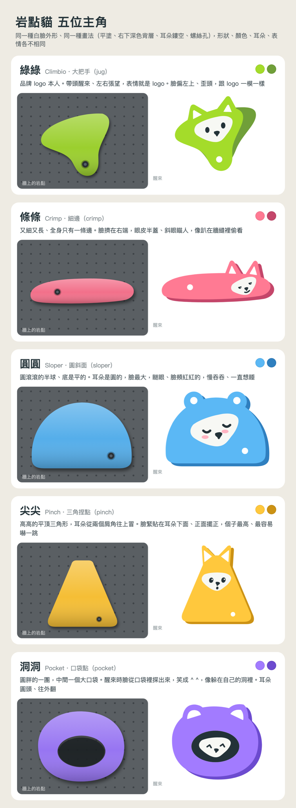

# 岩點貓五位主角

綠綠是品牌 logo 本人，另外四隻是同一家族的主角。形狀、顏色、耳朵、表情各不相同，畫法一樣：

- **平塗**：沒有描邊和漸層。身體後面有一層往右下錯位的深色背層，當作厚度。
- **鏤空**：耳朵中間挖空一個小形狀；身上有一個鏤空的螺絲孔（洞洞沒有，它的口袋就是洞）。
- **白臉**：外形全家一樣，都是 logo 的白臉，只換眼睛和嘴巴。
- **牆上的岩點只有身體外形**：沒有耳朵和臉，醒來時耳朵才冒出來、臉才浮上來。

| | 綠綠 | 條條 | 圓圓 | 尖尖 | 洞洞 |
|---|---|---|---|---|---|
| 岩點 | 大把手（jug） | 細邊（crimp） | 圓斜面（sloper） | 三角捏點（pinch） | 口袋點（pocket） |
| 主色／背層 | `#A4DC2A`／`#709F39` | `#FF7A93`／`#C4466A` | `#5BB8F5`／`#2F7FBF` | `#FFC83D`／`#CC9214` | `#A27BFF`／`#6C4BCF` |
| 身體 | logo 的身體，正放 | 又細又長的一條邊 | 平底半球 | 平頂的高三角形 | 圓胖的一團，中間一個大口袋 |
| 耳朵 | logo 的尖耳朵 | 小尖耳，擠在右端 | 圓耳朵、圓形鏤空 | 從兩個肩角往上冒 | 圓頭、往外翻 |
| 臉 | 偏左上、歪頭，跟 logo 一樣 | 擠在右端 | 最大、正面朝前 | 緊貼在耳朵下面、擺正 | 從口袋裡探出來 |
| 表情 | logo 的表情 | 眼皮半蓋、斜眼瞄人、嘴角一邊翹 | 瞇成兩道彎、臉頰紅紅的 | 大圓眼有亮點、嘴巴一個小 o | 笑成 ^ ^ |
| 個性 | 帶頭的，愛左右張望 | 愛躲在牆縫偷看 | 慢吞吞、一直想睡 | 個子最高、最容易嚇一跳 | 躲在自己的洞裡 |

## 在程式裡

- 形狀、顏色、臉的位置和表情都寫在 `js/holdcat.js` 的 `CAST`，以那裡為準。每隻用自己的座標，綠綠用的就是 logo 的座標。
- App 已移除內建示範牆與固定五隻角色座標，不再於分享模組維護角色位置。
- 一般牆面依實際岩點外框與顏色產生醒來動畫，選出的岩點不綁定固定的角色或位置，詳見[岩點貓動畫](../../docs/holdcat.md)。
- 五位主角保留為視覺設計參考；若要在其他情境安排專屬出場，應另行設計，不依賴內建示範牆。
